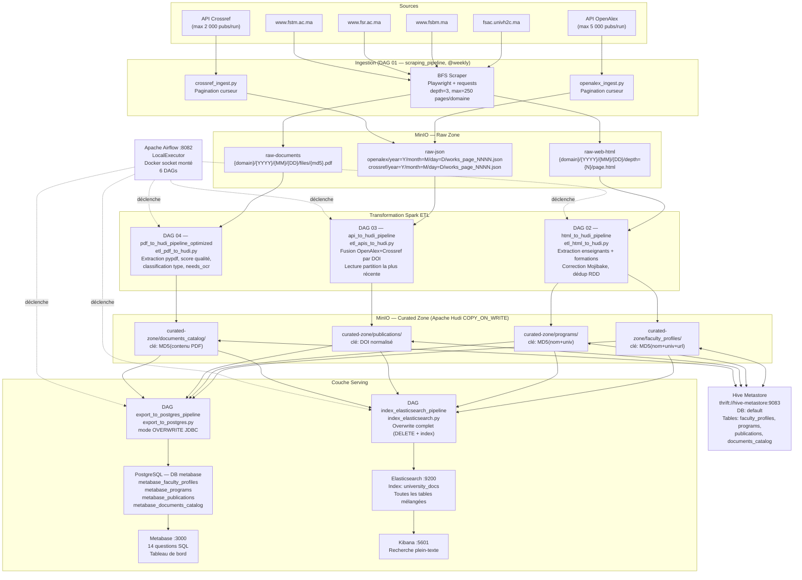

# Architecture — University DATA

## Diagramme Mermaid du flux complet



---

## Flux MinIO — détail des chemins

```
MinIO
├── raw-web-html/
│   └── {domain}/
│       └── {YYYY}/{MM}/{DD}/
│           └── depth={N}/
│               └── {safe_filename}.html
│
├── raw-documents/
│   └── {domain}/
│       └── {YYYY}/{MM}/{DD}/
│           └── files/
│               └── {md5(url)}.pdf   ← nom = hash de l'URL source
│
├── raw-images/
│   └── {domain}/{YYYY}/{MM}/{DD}/images/{md5(url)}.{ext}
│
├── raw-json/
│   ├── openalex/year=YYYY/month=MM/day=DD/works_page_NNNN.json
│   └── crossref/year=YYYY/month=MM/day=DD/works_page_NNNN.json
│
├── raw-logs/
│   └── errors/
│
└── curated-zone/
    ├── faculty_profiles/
    │   └── .hoodie/  ← métadonnées Hudi (commits, timeline)
    ├── programs/
    ├── publications/
    └── documents_catalog/
```

---

## Schémas des tables Hudi

### `faculty_profiles`
| Champ | Type | Source |
|---|---|---|
| record_id | String | MD5(full_name + university + source_url) |
| full_name | String | Extraction HTML |
| title | String | Civilité déduite (Pr. → Professeur, Dr. → Docteur) |
| department | String | Contexte DOM autour du nom |
| university | String | Nom de domaine (ex: fsac.univh2c.ma) |
| source_system | String | Toujours "web_scraping" |
| source_url | String | s3a://raw-web-html/{key} |
| crawl_timestamp | String | ISO-8601 UTC |
| content_hash | String | MD5 du HTML nettoyé |
| is_deleted | Boolean | Toujours false |
| extraction_method | String | "html_parsing" |

### `programs`
| Champ | Type | Source |
|---|---|---|
| program_id | String | MD5(program_name + university) |
| program_name | String | Extraction HTML (6 stratégies) |
| level | String | Doctorat / Master / Licence / Filière |
| department | String | Contexte DOM |
| faculty | String | Domaine/université |
| responsible | String | Responsable si dans tableau HTML |
| source_url | String | s3a://raw-web-html/{key} |
| crawl_timestamp | String | ISO-8601 |

### `publications`
| Champ | Type | Source |
|---|---|---|
| work_id | String | URI DOI normalisé (clé primaire) |
| doi | String | DOI au format 10.xxxx/xxxx |
| title | String | Titre HTML-strippé |
| publication_date | Date | Date de publication |
| type | String | journal-article, conference-paper… |
| cited_by_count | Integer | Crossref uniquement |
| author_names | Array[String] | Liste des noms d'auteurs |
| author_orcids | Array[String] | ORCID des auteurs |
| author_institutions | Array[String] | Institutions |
| publisher | String | Éditeur (Crossref) |
| source_system | String | "openalex" ou "crossref" |
| crawl_timestamp | Timestamp | Horodatage Spark |

### `documents_catalog`
| Champ | Type | Source |
|---|---|---|
| record_id | String | MD5 du contenu binaire PDF |
| source_path | String | s3a://raw-documents/{key} |
| file_name | String | Nom du fichier |
| document_type | String | schedule / results / academic_program / announcement / administrative / other |
| program_name | String | Formation détectée |
| academic_year | String | Ex: 2025/2026 |
| semester | String | Ex: S1; S3 |
| student_count | Integer | Nb numéros Apogée (si student_list) |
| needs_ocr | Boolean | Vrai si PDF scanné non extractible |
| extraction_quality_score | Double | Score 0→1 |
| extraction_status | String | success / partial_success / failed |
| crawl_timestamp | String | ISO-8601 UTC |

---

## Infrastructure Docker

```
docker network: data-platform-net (bridge)

univdata-postgres          postgres:13
  ├── DB airflow           → Airflow scheduler/webserver
  ├── DB hive_metastore    → Hive Metastore JDO store
  └── DB metabase          → Metabase + tables exportées

univdata-minio             minio/minio:latest       :9000 :9001
univdata-minio-setup       minio/mc:latest          (one-shot, crée les buckets)
univdata-hive-metastore    build ./hive             :9083
univdata-spark-master      build ./spark            :7077 :8080
univdata-spark-worker      build ./spark            :8081  (2 cores, 3g RAM)
univdata-elasticsearch     build ./elasticsearch    :9200 :9300
univdata-kibana            kibana:8.10.2            :5601
univdata-airflow-init      build ./airflow          (one-shot, init DB)
univdata-airflow-webserver build ./airflow          :8082
univdata-airflow-scheduler build ./airflow
univdata-metabase          build ./metabase         :3000
```
